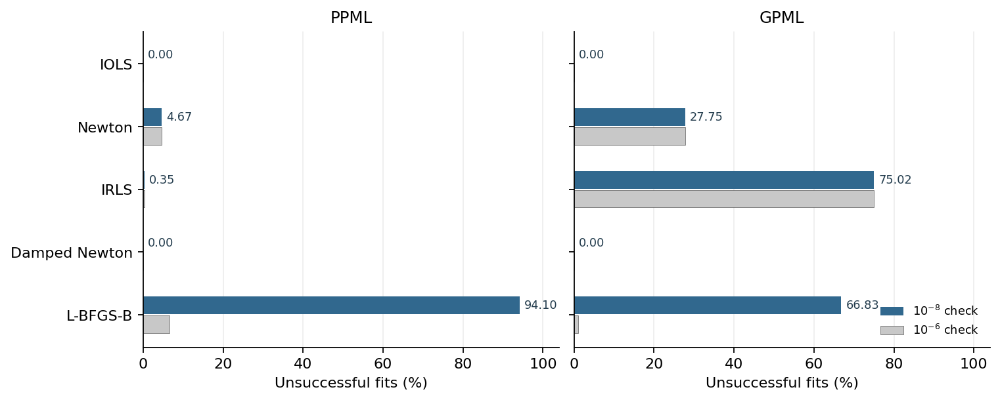
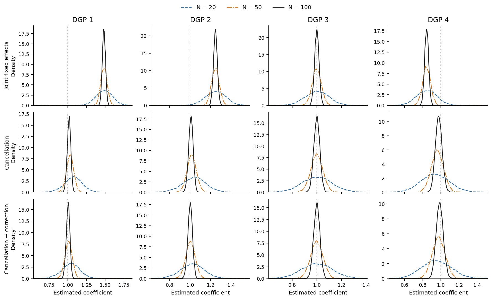

# Dealing with Logs and Zeros: Python replication

Replication files for **Dealing with Logs and Zeros in Regression Models**, by David Benatia, Christophe Bellégo and Louis-Daniel Pape.

**Paper:** [arXiv:2203.11820](https://arxiv.org/abs/2203.11820).

This standalone repository contains the historical Python implementations for the paper's WZ fixed-effect simulations and six-method IOLS/solver comparison. The numerical kernels used for these studies are bundled. The general [powermean package](https://github.com/dvbn/powermean) is developed separately.

## Key results

These displays reproduce the historical simulation results bundled with this repository. They are separate from benchmarks of the current powermean package.

### Solver comparison

Each solver cell reports **failure (%) · median/mean CPU time (ms)**. Failure means no output satisfying the common 10⁻⁸ accuracy check within 120 CPU and 300 elapsed seconds. Timing summaries include every attempted fit after clipping each recorded CPU time to 120 seconds; certified structural exclusions are outside the attempted-fit denominator.

| Designs | n | Equation | IOLS (C++) | Newton | IRLS |
|---|---:|---|---:|---:|---:|
| Ordinary | 1,000 | PPML | 0.00 · 2.4/2.7 | 0.00 · 1.0/1.1 | 0.00 · 1.2/1.3 |
| Ordinary | 1,000 | GPML | 0.00 · 2.7/8.1 | 1.94 · 1.0/28 | 0.07 · 2.8/12 |
| Ordinary | 10,000 | PPML | 0.00 · 106/111 | 0.00 · 67/70 | 0.00 · 200/206 |
| Ordinary | 10,000 | GPML | 0.00 · 115/118 | 0.32 · 67/102 | 0.04 · 555/722 |
| Stress | 1,000 | PPML | 0.00 · 3.4/4.8 | 0.15 · 1.2/9.3 | 0.15 · 1.5/7.8 |
| Stress | 1,000 | GPML | 0.00 · 3.3/6.5 | 14.62 · 1.5/436 | 40.98 · 3.4/2,223 |
| Stress | 10,000 | PPML | 0.00 · 158/202 | 4.67 · 113/1,643 | 0.35 · 397/496 |
| Stress | 10,000 | GPML | 0.00 · 144/192 | 27.75 · 105/14,831 | 75.02 · 339/419 |

Newton and IRLS use statsmodels. The [full solver table](reference/tables/solver_preliminary_main.tex) and [numerical inputs](saved/solvers/paper_main_summary.csv) are also available.

#### Accuracy in the larger stress designs



Each method/equation group contains 4,000 attempted fits at n=10,000 and K=100. Blue and gray bars use the 10⁻⁸ and 10⁻⁶ checks, respectively, with the same common computing budget. Separate NumPy IOLS results are retained in the appendix.

### Fixed-effect simulations



The figure uses T=2 and N=20/50/100, with 5,000 replications per cell. The dotted line marks the true coefficient, 1. Every draw contributes to its density curve.

#### Bias, standard errors and coverage

The main table below uses **N=50/100/500 and T=2**. Each DGP cell reports **Bias/SD / Mean SE/SD / Coverage (%)** from 5,000 replications. Coverage is for nominal 95% normal intervals.

| N | Method | DGP 1 | DGP 2 | DGP 3 | DGP 4 |
|---:|---|---:|---:|---:|---:|
| 50 | GJ | 11.48 / 0.98 / 0.0 | 6.52 / 0.99 / 0.0 | -0.02 / 0.98 / 94.3 | -3.59 / 0.96 / 4.7 |
| 50 | GC | 0.63 / 0.88 / 84.3 | 0.36 / 0.91 / 89.8 | -0.02 / 0.90 / 91.8 | -0.57 / 0.83 / 83.3 |
| 50 | GC+BC | 0.20 / 0.85 / 89.1 | 0.09 / 0.88 / 91.4 | -0.02 / 0.86 / 90.9 | -0.34 / 0.77 / 84.5 |
| 50 | PJ | 0.58 / 0.89 / 85.5 | 0.35 / 0.92 / 90.3 | 0.01 / 0.90 / 92.0 | -0.55 / 0.83 / 84.3 |
| 50 | PJ+BC | 0.10 / 0.85 / 89.8 | 0.04 / 0.89 / 91.7 | -0.03 / 0.86 / 90.8 | -0.30 / 0.77 / 84.6 |
| 100 | GJ | 22.64 / 0.96 / 0.0 | 13.16 / 0.99 / 0.0 | -0.02 / 0.99 / 94.5 | -7.19 / 0.97 / 0.0 |
| 100 | GC | 0.66 / 0.94 / 86.7 | 0.36 / 0.96 / 91.9 | -0.03 / 0.94 / 93.2 | -0.65 / 0.85 / 82.3 |
| 100 | GC+BC | 0.12 / 0.91 / 92.1 | 0.04 / 0.94 / 93.0 | -0.02 / 0.91 / 92.2 | -0.33 / 0.79 / 85.5 |
| 100 | PJ | 0.59 / 0.95 / 88.8 | 0.35 / 0.96 / 92.5 | 0.01 / 0.94 / 93.4 | -0.64 / 0.85 / 83.2 |
| 100 | PJ+BC | 0.04 / 0.92 / 92.6 | 0.00 / 0.95 / 93.6 | -0.03 / 0.91 / 92.4 | -0.29 / 0.79 / 86.0 |
| 500 | GJ | 99.63 / 0.84 / 0.0 | 64.93 / 0.97 / 0.0 | -0.01 / 0.99 / 95.4 | -32.91 / 0.89 / 0.0 |
| 500 | GC | 0.70 / 0.97 / 87.7 | 0.39 / 0.98 / 92.5 | -0.02 / 0.97 / 94.4 | -0.84 / 0.92 / 81.7 |
| 500 | GC+BC | 0.05 / 0.95 / 93.7 | 0.01 / 0.97 / 94.4 | -0.02 / 0.97 / 94.3 | -0.26 / 0.87 / 89.9 |
| 500 | PJ | 0.59 / 0.98 / 89.5 | 0.36 / 0.98 / 92.9 | 0.01 / 0.98 / 94.6 | -0.85 / 0.92 / 81.9 |
| 500 | PJ+BC | 0.00 / 0.96 / 94.0 | -0.01 / 0.98 / 94.6 | -0.02 / 0.97 / 94.3 | -0.23 / 0.87 / 90.3 |

**GJ:** joint GPML. **GC:** cancelled GPML. **GC+BC:** generic coefficient correction. **PJ:** cancelled PPML. **PJ+BC:** WZ-corrected PPML coefficient with the ordinary pair sandwich. The N=500 extension is independent of the smaller-size draws.

See the [full fixed-effect table](reference/tables/fe_T2_main_body.tex) and [replication details](docs/replication.md) for the covariance comparisons and separate higher-order pilot.

Run `python run.py --mode report --check-reference` to regenerate the figures and tables from the supplied numerical inputs.

## Rebuild the paper tables and figures

Use Python 3.14. The checked environment uses CPython 3.14.3; dependency versions are in `requirements.txt`.

```bash
python3.14 -m venv .venv
source .venv/bin/activate
python -m pip install -r requirements.txt
python run.py --mode report --check-reference
```

On Windows, activate the environment with `.venv\Scripts\activate` instead. Numerical simulation runners require Linux or macOS; report mode uses ordinary Python/NumPy/Matplotlib.

The command regenerates eight LaTeX table files, numerical CSV tables and two figures in PDF/PNG format under `outputs/report/paper/`. It checks the displayed table values against the supplied paper references. It performs no estimation and needs no compiler, LaTeX installation, account or external service. Only NumPy and Matplotlib are needed if installing dependencies just for this reporting step.

Saved inputs are restricted to the current displays. `reference/` contains expected paper tables and figures; `saved/` contains the numerical inputs used to regenerate them. The regenerated figures preserve the plotted numerical content with updated typography/layout.

## Run a small numerical example

Install CMake, a C++17 compiler, BLAS/LAPACK and Eigen headers for the native IOLS method. Build using the same Python environment:

```bash
python solvers/build_native.py --eigen-include /path/to/eigen3
python run.py --mode smoke
```

The Eigen directory must contain `Eigen/Core`. Eigen 3.4 or later is required; the checked local build uses Eigen 5.0.1. The script builds with one compilation job, optimized release settings and the historical floating-point flags. It does not download headers. Compiled binaries are built locally and are not distributed in this repository.

The smoke command runs a small WZ example, one covariance-pilot case, and both equations through all six solver methods. Results go to `outputs/smoke/`. A missing native module is reported explicitly. To run only WZ, which does not need this C++ module:

```bash
python run.py --mode smoke --study wz
```

## Rerun the simulations

```bash
python run.py --mode full
```

This is a substantial simulation campaign: 180,000 base WZ draw-cells, 20,000 independent N500 extension draw-cells, the separate 400-case covariance pilot, and 480,000 scheduled solver records across 40,000 datasets. Default execution is sequential with one BLAS/OpenMP thread per process. Completed case records are saved for resumption. Once both complete studies have finished, their own results are used to rebuild the displays under `outputs/full/paper/`.

To continue an interrupted run, repeat the same command with `--resume`. Keep the code, dependencies and scientific options unchanged. A fresh output directory is required for a different configuration.

Useful restricted runs:

```bash
python run.py --mode full --study wz --paper-only
python run.py --mode full --study solvers
python run.py --mode full --replications 2 --output outputs/small
```

`--paper-only` selects the WZ T=2 cells used in the current displays while retaining the original generator's master dimensions and seeds. An explicit replication limit creates a numerical subset and skips automatic paper reporting. Study-specific cell and method selectors are documented in the study READMEs. A subset is not the full Monte Carlo result.

For complete results previously generated in another directory:

```bash
python run.py --mode report --input-root outputs/full --output outputs/rebuilt
```

Original CPU timings are reproduced by the saved-result route. New simulation timings depend on the machine and environment. The full solver runner preserves the original distinction between prospectively capped calls and historical uncapped calls; the common 120 CPU / 300 elapsed-second reporting rule is applied separately.

## Contents and interpretation

- `wz/`: generators, historical numerical routines, configuration and covariance pilot. See [WZ instructions](wz/README.md).
- `solvers/`: six-method comparison, native build and scientific execution schedule. See [solver instructions](solvers/README.md).
- `reporting/`: small saved-result renderers.
- `saved/` and `reference/`: inputs and expected paper outputs.
- [Replication details](docs/replication.md): output map, seeds, method definitions and numerical qualifications.

Failures, structural exclusions and invalid inference are retained. Full reruns do not substitute a different estimator, relax the paper's acceptance thresholds, or silently replace C++ IOLS with NumPy.

The included authored code is released under [BSD-3-Clause](LICENSE). Applicable upstream notices are retained in the source and [third-party notices](THIRD_PARTY_NOTICES.md). Please cite the paper; citation metadata are in `CITATION.cff`.
